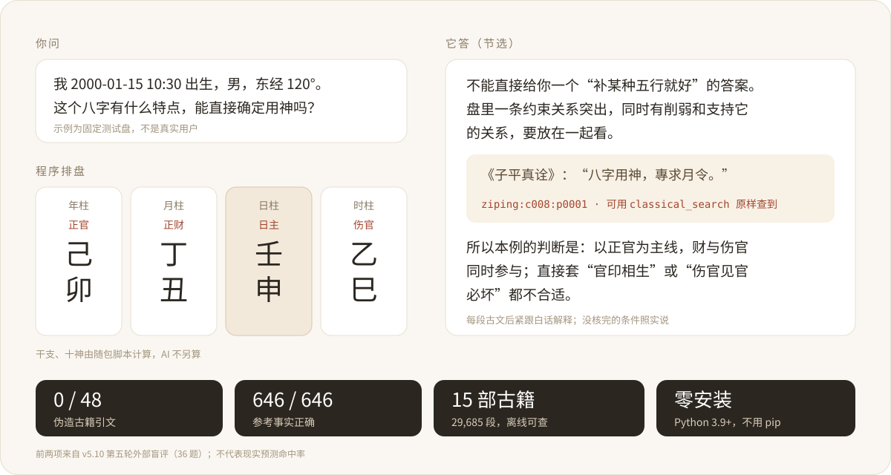

<div align="center">

# Chinese Fortune · 有据算命

**Chinese fortune-telling for your AI, read from the classical texts themselves: a plain answer first, and every quotation traceable to its passage.**

[](https://skills.sh/shousenzhang/chinese-fortune)
[](https://github.com/ShousenZHANG/chinese-fortune/actions/workflows/ci.yml)
[](https://github.com/ShousenZHANG/chinese-fortune/releases)
[](#install)
[](LICENSE)



[中文](README.md) · [Sample report and share card](site/) · [Install](#install) · [What to ask](#what-to-ask) · [Why trust it](#why-trust-it) · [Capabilities](#capabilities) · [Update and remove](#update-and-remove)

</div>

## How it differs from asking a model directly

| Asking a model directly | With this skill |
|---|---|
| Ask about the same chart three times, possibly get three answers | Stems, ten gods and day grades come from bundled scripts: same input, same result |
| Quotations that cannot be found anywhere | Every quotation carries a passage id you can retrieve verbatim; answers are checked before sending |
| Jargon throughout | A plain conclusion first; each term explained where it first appears |
| Either alarming or overconfident | No scores, no guarantees, no health verdicts; unchecked conditions are said as such |
| Time zones and daylight saving guessed | Birth time zone, historical DST, true solar time, solar terms and day boundaries handled separately |
| Birth details retyped every time | After you confirm, a local profile lets you just say "me" next time |

**Measured** (rounds and method in the [source note](docs/核实记录/2026-11-08-首屏实测数字的来源.md), Chinese):

- Fifth external verification (2026-10-31, 36 tasks, independently computed references): 646/646 reference facts correct, 0/48 fabricated classical quotations, 0/36 out-of-bounds answers.
- Zi Wei charts against iztro 2.6.5, palace by palace: 903/903 identical.
- Latest round of 16 hard cases that failed before: only 3 pass strict review. The 90% target is not met yet.

The repository also ships two independent skills: **life-guide** answers everyday questions from the life guide 《高性价比人生指南》 (emergencies get the first action first), and **fortune-extras** does tarot, sun signs and dream symbols. Install only what you need.

## Install

The easiest way is to send your AI this line:

> Install this skill: https://github.com/ShousenZHANG/chinese-fortune

| Host | Command |
|---|---|
| Claude Code | `/plugin marketplace add ShousenZHANG/chinese-fortune`, then `/plugin install chinese-fortune@chinese-fortune` |
| Claude Code slash commands | After installing the plugin: `/chinese-fortune:bazi` (BaZi), `/chinese-fortune:days` (good days), `/chinese-fortune:hehun` (compatibility), `/chinese-fortune:year` (a year), `:week`, `:month`, `:areas` (career, wealth, relationship, study); plain questions work too |
| The other two skills in this repository | Everyday life questions `life-guide`; tarot, sun signs and dreams `fortune-extras`: replace `chinese-fortune` with the skill name in the commands above (Claude Code: `/plugin install life-guide@chinese-fortune`) |
| Codex, Cursor, GitHub Copilot, Gemini CLI and others | `npx skills add ShousenZHANG/chinese-fortune --skill chinese-fortune` |
| Gemini CLI (built-in command) | `gemini skills install https://github.com/ShousenZHANG/chinese-fortune --path skills/chinese-fortune` |
| claude.ai, ChatGPT, Claude API | Download `chinese-fortune-v<version>.zip` from [Releases](https://github.com/ShousenZHANG/chinese-fortune/releases): upload it in claude.ai under Settings > Features, in ChatGPT (Business, Enterprise, Edu) under Plugins > Skills, or through the Claude API's Skills API |
| MCP-only hosts (Claude Desktop, Cursor, VS Code and others) | Extract the same zip and add the entry below |

```json
{"mcpServers": {"chinese-fortune": {"command": "python", "args": ["/path/to/chinese-fortune/scripts/mcp_server.py"]}}}
```

For MCP on Windows, use `py` with `"-3"` as the first argument. Tools are listed automatically, and SKILL.md plus the references are served as resources. The two scripts that write personal data (saved profiles, prospective log) are not exposed over MCP.

Python 3.9 or later is all it needs (the `python3` that ships with macOS will do): nothing to pip install, and calculations need no network, because lunar_python and the tzdata time-zone data ship inside `scripts/`. CI checks Python 3.9, 3.11, 3.12 and Windows. After installing, run the self-check from the skill directory and look for `"healthy": true`:

```sh
python scripts/doctor.py
```

<details>
<summary>Install notes for AI agents</summary>

1. Use the install method above for the user's host. When unsure, extract the Release zip into the host's skills directory (Claude Code `~/.claude/skills/`, Codex `~/.codex/skills/`, Gemini CLI `~/.gemini/skills/`) so that `chinese-fortune/SKILL.md` exists.
2. Do not run pip. Try `python3`, `python`, then `py -3` for one that is 3.9 or later; if none exists, ask the user before installing Python (commands in SKILL.md, “运行环境与诊断”).
3. Run `python scripts/doctor.py` inside the chinese-fortune folder; it prints `"healthy": true` when ready, otherwise follow `next_step`.

</details>

## What to ask

For a fortune question the AI first asks for the birth details that question needs (date, time, birthplace, sex) and the city you live in now. A time you only remember roughly can be a range, such as 19:00–20:00; text lookup needs no birth data.

| You want | Ask |
|---|---|
| Your BaZi | Born 1990-05-10 at 14:30, male, Beijing; currently in Sydney. Explain the main BaZi structure in plain language, including applicable conditions and exceptions. |
| Good days | Which day next month is good for moving? Which of the next seven days are good for me? |
| An interview slot | I can interview Tuesday morning or Thursday afternoon next week, one hour each. Which one? |
| Career, wealth, relationships, study | How do my career and finances look? A quick read of my life areas. |
| Luck cycle, a year, this week or month | Is my current ten-year cycle favourable? How does 2027 look? How is this week, this month? |
| Colours to wear | Which colours and accessories suit me? |
| Almanac, Liu Yao, Qi Men | Can I move house on 29 October? Cast Liu Yao for next Tuesday's interview. Which hour next week suits travel? |
| A classical text | How does Zi Ping Zhen Quan understand 用神? Explain, then give the passage. |
| Everyday life | I lost my job: what first? Should I stand surety for a friend? |

Answers come in Chinese: the conclusion first in plain language, then short quotations, each followed at once by its meaning and why it applies to you. See the [plain-language output example](skills/chinese-fortune/docs/OUTPUT-EXAMPLE.md), written from a fixed test chart rather than a real person's forecast.

## Capabilities

| Method | Answers | Basis |
|---|---|---|
| BaZi natal chart | structure, 用神, conditions for success or failure | 《子平真诠》 month structure first; 《滴天髓》《穷通宝鉴》《三命通会》《渊海子平》 compared; 8 families, 25 review paths, 46 pattern conditions |
| Life areas | career, wealth, relationships, study | the star or palace the classics read for each (官星, 财, the spouse palace and star, a woman's 官, 学堂); where it sits in the chart, and which of the current cycle and the next three years carry it, stem or hidden stems alike, each with its passage; no year is called good or bad, no health verdicts |
| Ten-year luck cycle | conditional readings for each candidate configuration | All eight 《子平真诠》 luck families, 49 scenarios; unresolved conditions and contrary exceptions stay visible |
| A year (流年) | a named year, this year, next year | 《渊海子平》《三命通会》《滴天髓》 on the year star, listed relation by relation, no total score |
| Personal good days, periods | which days are good or to avoid | 《协纪辨方书》 vol. 33 相主, graded 大吉 to 大凶 by birth year |
| Appointment times | interview, exam, travel, moving | 相主 plus event day rules; interviews and exams also 《奇门遁甲元灵经》 |
| Colours, accessories | what to wear | 《穷通宝鉴》 general 调候 choice (the cell's exceptions not checked against your chart) |
| Almanac | a day's dos and don'ts, a day for several people | sourced day rules from 《协纪辨方书》《渊海子平》; with several people each gets their own 相主 grade, never a combined score |
| Zi Wei, Liu Yao, I Ching, Mei Hua, Qi Men, Liu Ren | when you name them | frozen transcriptions, within documented coverage; Zi Wei adds yearly Dou Jun down to hourly layers; Liu Yao judges the rule-library conditions the chart decides, gives candidate timing branches and the opposite and reversed hexagrams, and shows both sides when the book contradicts a rule; Mei Hua casts by object count, sound, length and the 端法 object and direction methods with the book's own timing; Qi Men offers the 《遁甲演义》 rotating plate, its volume-two patterns, hour selection and optional intercalated (置闰) bureau setting; Liu Ren covers all nine transmission methods and the 本命行年 |
| Marriage, family and partnership pairing | which pillars of two people combine, clash or punish | position-by-position relations and each day master's ten-god view of the other, clauses filtered by relationship type; classified, never scored; marriage also gets the 《选择要略》 three-yuan nine-palace match with its recorded objection |
| Uncertain or corrected birth data | unsure birth hour, a wrong date | which pillars stay and which change, and which conclusions they touch; both hour pillars when the time sits near an hour boundary or a daylight-saving record is unclear; reverse lookup from four pillars to dates; life events compared across candidate hours without picking one (no classical basis) |
| Feng Shui facing | which of the 24 mountains a measured bearing falls in | 《协纪辨方书》 24-mountain classification; a measurement error that crosses a boundary asks for a re-measure; no verdicts |
| Purple-white nine stars | where 五黄 sits this year, which palace gets 紫白 this month, day or hour | 《协纪辨方书》 vol. 8 year and month tables reproduced cell by cell, day and hour by 《选择要略》; with a sitting mountain, marks whether 紫白 reaches it |
| Classical text lookup | passages, editions, context | 15 frozen transcriptions, 557 units, 29,685 paragraphs, offline; the 焦氏易林 in the Sibu Congkan and Siku editions, side by side by hexagram pair |
| Report and share card | save a report, post an image | `bazi_reading.py --report` saves a review report, `--card` an SVG share card; `--card-redact` hides birth details and stems and branches, keeping ten-god relations, clause status and passage ids |
| Everyday life (life-guide skill) | layoffs, guarantees, deposits, insurance | 《高性价比人生指南》 660 entries in 34 sections, 8 long articles; emergencies and self-harm get the first action first |

A complete transcription, implemented rules, image collation and predictive validity are separate claims: computable conditions are checked by the scripts, while strength, cooperation and rescue are argued by the AI from the full passages. Tests do not establish predictive accuracy. Supported conventions and input changes are in the [6.0 migration notes](skills/chinese-fortune/docs/MIGRATION-6.0.md).

## Why trust it

- **Scripts compute, the AI explains**: stems, ten gods, day grades and luck verdicts come from the bundled scripts; the AI turns them into plain language and does not recompute them.
- **Every quotation is traceable**: book and paragraph id, retrievable verbatim with `classical_search.py --passage-id`.
- **Unclear stays unclear**: tied options, unchecked conditions and books that disagree are said as such; nothing is picked for you and sources are never counted as votes.
- **Time done properly**: birth time zone, DST, true solar time, day boundaries and solar terms are handled separately; a remembered range is compared minute by minute.
- **Checked before sending**: `answer_check.py` verifies that quotations exist verbatim in the bundled classics, that named pillars match the chart, and that no unproduced score or certain outcome slipped in.
- **Checkable afterwards**: with your consent a forecast is frozen beforehand and the outcome recorded later, see [prospective validation](skills/chinese-fortune/references/28-prospective-validation.md).

## Privacy

Birth details in this repository's examples, tests and evaluations are fictional; none belongs to a real person.

Charts, date selection and text lookup run in the bundled scripts on your computer (or the host's sandbox), offline, and do not save your birth details or questions; your conversation with the AI still goes through whichever AI service you use. The one network call is the optional quantum randomness source for divination casts: it fetches random bytes only, carries no personal data, and falls back to local randomness.

Optional, explicitly confirmed profiles support updates, inspection and deletion outside the repository and installed skill. The default is `~/.local/share/chinese-fortune`.

## Update and remove

| Installed with | Update | Remove |
|---|---|---|
| Claude Code plugin | `claude plugin marketplace update chinese-fortune`, then `claude plugin update chinese-fortune@chinese-fortune` | `claude plugin uninstall chinese-fortune@chinese-fortune` |
| npx skills | `npx skills update chinese-fortune` | `npx skills remove chinese-fortune` |
| Gemini CLI | uninstall, then install again | `gemini skills uninstall chinese-fortune` |
| zip upload | upload the new zip | delete it in the host's Skills settings |

Changes per version are in the [CHANGELOG](CHANGELOG.md).

## Repository layout

```text
skills/chinese-fortune/     the installed skill (npx skills, Claude Code plugin, release zip)
├── SKILL.md                workflow and method routing for the AI
├── scripts/                charting, date selection, lookup and checks; lunar_python and tzdata in vendor.zip
├── references/             per-method rules, read on demand
├── knowledge/              the fifteen frozen transcriptions (books.zip)
├── assets/                 rule libraries and classical clauses
└── docs/                   methods, sources, migration and release notes
skills/life-guide/          everyday life questions (the life guide), installed separately
skills/fortune-extras/      tarot, sun signs and dreams, installed separately
corpus/sources.zip          raw pages and capture records for rebuilding and re-verifying; not installed with the skill
tests/  evals/  docs/       development tests and evaluation records, not installed
```

## Details

<details>
<summary>How personal day grades work, and which undertakings are covered</summary>

Which days are good or bad for you is answered by 相主 from 《协纪辨方书》 volume 33, which judges the chosen time's year, month, day and hour pillars against the stem and branch of the year you were born (「從來皆論生年不論生日」). A year or month that clashes your birth year is said first and no day inside it is called good, since changing the day does not avoid it. Each day is graded 大吉 to 大凶 with its reasons and passages; a period gets its best and worst days, and candidate slots are ordered by grade first, then by your stated preference. Travel, weddings, moving and business openings first exclude event days (天地转杀 from 《渊海子平》, and the prohibitions 协纪 says no auspicious spirit can lift).

This is not a whole-chart reading. Travel, weddings, moving and opening a business are on 协纪's list of commoners' undertakings (民用三十七事, `xieji:c011:p0005`); interviews, exams, dates, salary talks and quotes are not, so for those the method is borrowed and the answer says it is a 相主 grade comparison. The generated coverage table is in the Chinese README.

</details>

<details>
<summary>Periods, interviews and appointment windows</summary>

`python scripts/fortune_reading.py --stdin` accepts confirmed people, the current location, a target period, the event location, available windows, duration and busy intervals. It resolves relative dates, calculates natal and target facts separately, checks active ten-year cycles and filters real scheduling conflicts. Birth, current and event time zones stay distinct.

Candidate comparisons cover the entire event, including changes during it, and show the earliest and latest feasible start. Interview and exam requests also calculate the verified earth plate and chief star and door anchors of 《奇门遁甲元灵经》 across each window, with each person's birth-year stem; unknown cells remain unknown. Ordered multi-event requests check windows, durations, time zones and travel buffers together, and the plans returned are feasibility witnesses, not auspiciousness rankings. See the [request schema and research workflow](skills/chinese-fortune/references/24-personalized-forecast.md).

</details>

<details>
<summary>Everyday life questions (life-guide skill)</summary>

Plain real-life questions (what to do first after a layoff, whether to stand surety for a friend, whether a two-hour commute is worth it) go to the book's own decision workflow: `life_guide.py --decide` finds the entries, ranks them by fit and then by the book's cost-effectiveness tier and evidence grade, splits "do" from the book's "don't" list, cites section and entry for each, and names what the book does not cover. An emergency, a suicidal thought or a legal process already under way gets the first action before anything else, with hotline numbers only for someone in mainland China. The snapshot is eternity4719/HowToLiveBetter at commit `842e11c9` (text CC BY 4.0, ported search and workflow code MIT): the whole book except three entries, 660 entries in 34 sections, 8 long articles, section intros, the glossary and resolved cross references. Divination questions keep priority. See [life decisions](skills/chinese-fortune/references/29-life-decision.md).

</details>

<details>
<summary>Running the scripts directly</summary>

Run these from the skill directory (`chinese-fortune/`):

```sh
python scripts/bazi_reading.py --year 2000 --month 1 --day 15 --hour 10 --minute 30 --gender male --city 北京 --current-timezone Australia/Sydney --markdown
python scripts/huangli_query.py --date 2026-10-29 --question 这天搬家可以吗 --markdown
python scripts/liuyao_cast.py coins --question 下周二面试能过吗 --current-timezone Asia/Shanghai --markdown
python scripts/classical_search.py --list-books
python scripts/classical_search.py --passage-id ziping:c008:p0001
python scripts/classical_guidance.py --scenario interview --retrieve --limit 1
```

`--markdown` gives a chart-and-conditions draft; the AI completes the interpretive checks the question needs. Keep the birth time zone, the present-location time zone and the target time separate, and reuse `request_time.py`'s utc as `--request-time` within one request. Each script documents its options under `--help`.

</details>

<details>
<summary>Reading the results</summary>

An answer should say what is on the chart, why a clause applies and which exceptions would change the judgement. Where answers used to go wrong, the tools write the sentence themselves (`say` fields): how many minutes true solar time differs from the clock, which pillar each clock window gives when the birth time is unknown, each luck cycle's full and nominal ages, each luck verdict in the book's words, formations as candidates only, and compatibility grouped by combination, clash, punishment and harm. Answers copy them instead of recomputing. Field list: [MIGRATION-5.10](skills/chinese-fortune/docs/MIGRATION-5.10.md); 6.0 interface changes (result envelope, error classes, new entry points): [MIGRATION-6.0](skills/chinese-fortune/docs/MIGRATION-6.0.md).

When the 用神 is not on a Liu Yao hexagram, `fu_shen` follows 《增删卜易》. Zi Wei patterns follow the lines of 《紫微斗数全书》, each with its passage id, the exact line and four condition lists (required, bonus, breaking, to_check).

[Rules](skills/chinese-fortune/docs/BAZI-RULES.md) · [Output contract](skills/chinese-fortune/references/22-output-contract.md) · [Migration and validation](skills/chinese-fortune/docs/OUTPUT-VALIDATION.md)

</details>

<details>
<summary>Classical sources and the release archives</summary>

The library holds 《子平真诠》《滴天髓》《穷通宝鉴》《三命通会》《渊海子平》《协纪辨方书》《选择要略》《增删卜易》《紫微斗数全书》《梅花易数》《六壬大全》《遁甲演义》《奇门遁甲元灵经》 and two editions of 《焦氏易林》. "Complete" means the selected edition's chapter inventory is collected, not that every edition is compiled, every page collated against images or every rule implemented. [Sources](skills/chinese-fortune/docs/CLASSICAL-SOURCES.md) explain edition and licensing limits; [coverage](skills/chinese-fortune/docs/CONTENT-COVERAGE.md) separates verified clauses, partial support and gaps.

The runtime archive keeps every selected chapter and index; raw HTML/wiki provenance is in a separate `*-sources.zip` that ordinary users do not need. SHA256SUMS covers both.

</details>

## Development

Issues and pull requests are welcome; see [CONTRIBUTING](CONTRIBUTING.md) for the workflow and checks. From the repository root:

```sh
python -m pip install -r requirements-dev.txt -c constraints-dev.txt
python -m ruff check .
for d in skills/*/scripts; do python -m mypy "$d"; done
python -X utf8 -m pytest tests/ -q --cov --cov-report=term-missing
python skills/chinese-fortune/scripts/build_skill.py
python -X utf8 evals/package_smoke.py
```

Release builds use a full commit SHA, clean-install checks and the exact CI artifact; see the [release process](skills/chinese-fortune/docs/RELEASE-PROCESS.md). Recorded model-answer reviews stay separate from deterministic tests.

## License

Project code uses the standard [MIT license](LICENSE). Bundled dependencies, adapted code, corpus transcriptions, and life-guide text retain their own terms and attribution in [Third-party notices and full license texts](skills/chinese-fortune/THIRD_PARTY_NOTICES.md). The separate [product disclaimer](skills/chinese-fortune/DISCLAIMER.md) adds no license restrictions. These documents accompany the installed folder, runtime ZIP, and corpus-source ZIP.
